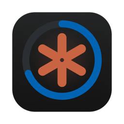
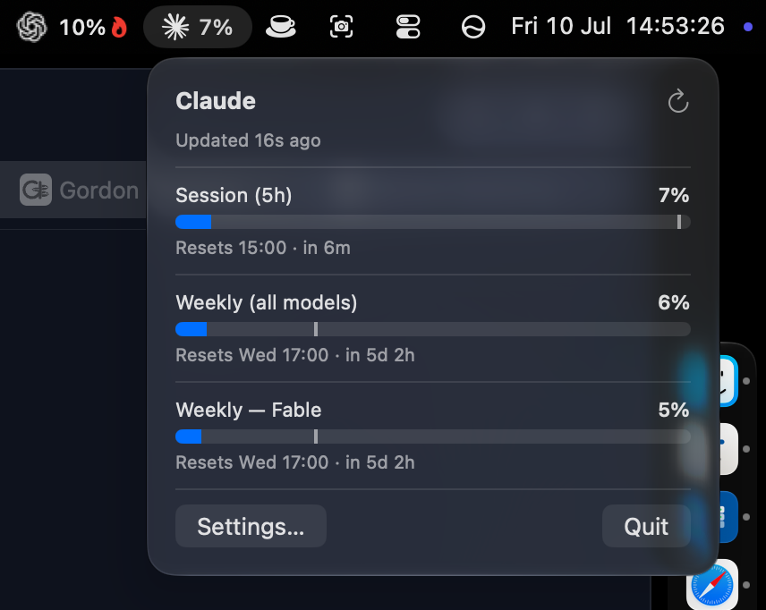

<p align="center">
  
</p>

<h1 align="center">ClaudeBar</h1>

<p align="center">
  Your Claude usage limits, in the macOS menu bar, in your timezone.
</p>

<p align="center">
  <a href="https://github.com/GordonBeeming/claude-bar/actions/workflows/build.yml"></a>
  <a href="https://github.com/GordonBeeming/claude-bar/releases/latest"></a>
  
</p>

---

ClaudeBar shows your Claude plan's usage limits in the menu bar — the same numbers you'd find on Claude's usage page, nothing more. The bar shows the highest percentage across your limits; the dropdown lists each one: session (5h window), weekly across all models, and any model-scoped limits like Fable or Sonnet, each with a progress bar and its reset time in your local timezone.

That's the whole app. No cost tracking, no charts, no extras. The menu renders instantly from cached data and refreshes in the background.

> Looking for the same simple menu bar experience for Codex? See [CodexBar](https://github.com/GordonBeeming/codex-bar).

## Preview

<p align="center">
  <a href="docs/screenshot.png">
    
  </a>
</p>

## Install

```sh
brew install --cask gordonbeeming/tap/claude-bar
```

Needs macOS 15+ on Apple Silicon, plus [Claude Code](https://claude.com/claude-code) installed and logged in — ClaudeBar reads its OAuth token from the Keychain (read-only; click **Always Allow** when macOS asks). It never writes or refreshes the token; that's Claude Code's job. If the token expires, ClaudeBar keeps showing the last known numbers with a hint to open Claude Code. macOS re-asks for that Keychain permission every so often — [Keychain access](#keychain-access) explains why, and how self-contained sign-in stops it.

### From source

```sh
make install
open ~/Applications/ClaudeBar.app
```

`make install` signs with your Apple Development identity when one exists, falling back to ad-hoc. Ad-hoc mints a fresh signing identity every build, so the Keychain prompt comes back after each rebuild; a real identity keeps the grant forever.

## Settings

Open **Settings…** from the dropdown:

- **Usage colours** — by default the icon turns orange/red when Claude's API says a limit is at warning/critical. Untick *Use Claude's severity levels* and you get a blue → orange → red bar: drag the two splitters to pick your own warning and critical percentages.
- **⛽ Fuel tank mode** — flip every percentage and progress bar from *used* to *remaining*. Instead of a limit filling up from 0 → 100% as you burn through it, it starts full and drains toward empty, like a fuel gauge. It's purely cosmetic: colours, the 🔥 over-pace flame, and the steady-pace marker all still track real usage, so a nearly-empty tank still turns red.
- **Telemetry** — off by default. Turn it on to keep your own usage history on disk (see [Telemetry](#telemetry)).
- **Launch at login** — on by default, toggle it here.

## Telemetry

ClaudeBar can write your usage history to disk in OpenTelemetry's OTLP JSON format, so you can chart it with `jq` and a spreadsheet or feed it into any OpenTelemetry tool. It's opt-in. Nothing is written until you tick **Record usage history** in Settings, and ClaudeBar never uploads the files. The folder is yours, though: if it syncs (Documents does when iCloud Desktop & Documents is on), the files sync with it, so choose a local folder if you'd rather they stayed on this Mac.

By default the files go to `~/Documents/ClaudeBar Telemetry`. You can choose another folder in Settings, along with how often to record (every 1, 5, 15, 30 or 60 minutes, default 5) and how long to keep files (7, 30, 90, 180 or 365 days, or forever; default 90). Each UTC day gets two files:

- `claudebar-metrics-YYYY-MM-DD.jsonl` holds one OTLP `ExportMetricsServiceRequest` per line, one line per recording.
- `claudebar-logs-YYYY-MM-DD.jsonl` holds one OTLP `ExportLogsServiceRequest` per line, written only when something changed.

The date in the name is the UTC date, so a file can start mid-morning or mid-evening your time. New files are created readable only by you (`0600`), and so is the folder if ClaudeBar creates it. Files older than the retention window are deleted. ClaudeBar only ever deletes files matching those two name patterns, so anything else in the folder stays put. That includes the `metrics-*.jsonl` and `logs-*.jsonl` files older versions wrote; delete those yourself when you no longer want them.

The format follows the [Bar Telemetry Spec](https://github.com/gordonbeeming/bar-ui/blob/main/docs/telemetry-spec.md) (v1), which [Bar UI](https://github.com/gordonbeeming/bar-ui) reads. Every record carries `bar.spec.version` = `"1"` as a resource attribute.

### Metrics

| Metric | Type | What it is |
|---|---|---|
| `bar.limit.utilization` | gauge, % | Each limit in the menu (session, weekly, per-model weekly). Attributes: `limit.id` (the API's `kind`, plus `:<model>` for a per-model limit), `limit.name`, `limit.window.duration_minutes` when the window length is known, `model.id` when the API gives one, plus `limit.kind`, `limit.group` and `model.name` |
| `bar.limit.resets_at` | gauge, Unix seconds | When that limit's window ends |
| `claude.usage.limit.window_elapsed` | gauge, % | How far through its window the limit is. Utilization above this means you're burning faster than an even pace |
| `claude.extra_usage.enabled`, `.used_credits`, `.monthly_limit`, `.utilization` | gauge | Pay-as-you-go extra usage, as the API reports it (`currency`, `decimal_places` attributes) |
| `bar.tokens` | cumulative sum | Tokens per `model` and `token.type`: `input`, `output`, `cache_read`, `cache_write_5m`, `cache_write_1h` |
| `claude.code.messages` | cumulative sum | Model responses per `model` |
| `claude.code.server_tool_requests` | cumulative sum | Web search and web fetch calls per `model` and `tool` |
| `bar.perk.available` | gauge | Guest passes you can still hand out (`perk.kind` = `guest_pass`, a count), and a promotional credit waiting to be claimed (`credit_grant`, its value in `perk.currency`, so US$20.50 is `20.5`) |
| `claude.guest_passes.limit` | gauge | How many guest passes you get in total |

Token counts come from Claude Code's transcripts in `~/.claude/projects`, because the usage API doesn't report tokens. That means they only cover Claude Code on this Mac. claude.ai, the desktop app and your other machines aren't included. Counting starts when you turn telemetry on rather than backfilling old transcripts. Turning it off and on again starts a new count with a new start time, which OpenTelemetry tools see as a counter reset.

### Events

The name is in each log record's `eventName` field.

| Event | When |
|---|---|
| `bar.tracking.started` | Counting started: telemetry was turned on, or back on after being off (`tracking.interval_minutes`) |
| `bar.limit.reset` | A limit's window rolled over. Carries `limit.utilization.last`, the last usage seen before the reset, and `limit.resets_at.next` |
| `bar.limit.appeared`, `bar.limit.disappeared` | A limit showed up in or dropped out of the API response (a new per-model limit, say) |
| `bar.perk.available`, `bar.perk.gone` | Guest passes or a promotional credit became available, or went away |
| `claude.limit.severity_changed` | A limit moved between normal, warning and critical |
| `claude.extra_usage.enabled_changed` | Extra usage was switched on or off |

The API doesn't say why a perk went away, so `bar.perk.gone` only carries `perk.gone.reason` = `used` when ClaudeBar can tell: the guest-pass count dropped while you're still eligible, or the API marks the credit as granted. In any other case the event has no reason attribute.

### Changing settings from another app

Another app can ask ClaudeBar to change its telemetry settings with a `claudebar://` link:

- `claudebar://telemetry?enabled=1&interval=5&retention=0&folder=<percent-encoded path>` takes any of those parameters. `interval` is in minutes (1 to 1440) and `retention` in days (0 keeps files forever, otherwise 1 to 3650). ClaudeBar always shows you the change, old value then new, and only applies it when you click **Apply**. If any value is invalid, nothing changes and ClaudeBar tells you why.
- `claudebar://settings` opens Settings.

The settings live in ClaudeBar's defaults (`telemetryEnabled`, `telemetryIntervalMinutes`, `telemetryRetentionDays`, `telemetryDirectory`), so other apps can read the current values from there.

Guest passes and credit grants come from the same account endpoints Claude Code uses for `/passes` and its promotions. They aren't a documented API, so if one stops answering, that part is skipped and everything else is still recorded. Your referral code and link are never written.

### Reading it with the OpenTelemetry Collector

The [OTLP JSON file receiver](https://github.com/open-telemetry/opentelemetry-collector-contrib/tree/main/receiver/otlpjsonfilereceiver) (`otlp_json_file`; older Collector releases call it `otlpjsonfile`) reads these files as they are. From there you can export to whatever backend you use:

```yaml
receivers:
  otlp_json_file:
    # The receiver starts at the end of each file by default, which would skip history.
    start_at: beginning
    include:
      - "/Users/you/Documents/ClaudeBar Telemetry/*.jsonl"
exporters:
  debug:
    verbosity: detailed
service:
  pipelines:
    metrics:
      receivers: [otlp_json_file]
      exporters: [debug]
    logs:
      receivers: [otlp_json_file]
      exporters: [debug]
```

## How it works

ClaudeBar polls `GET https://api.anthropic.com/api/oauth/usage` (once a minute, plus on menu open when stale) with the Claude Code OAuth token, and renders the `limits` array it gets back — one row per limit with percent used, a progress bar, and "Resets 5:00 pm · in 4h 55m" converted from UTC to your system timezone. The app is an accessory (no Dock icon, no app switcher entry); it just lives in the menu bar.

## Keychain access

By default ClaudeBar reads one Keychain item — Claude Code's `Claude Code-credentials` — to get the OAuth token the usage endpoint needs. In this mode it only reads: it never writes the item, refreshes the token, or touches the refresh token.

macOS gates that read behind a consent prompt. Click **Always Allow** and macOS trusts ClaudeBar for that item — until Claude Code next rotates its token. Claude Code refreshes its OAuth token a couple of times a day, and every refresh rewrites the Keychain item, which clears the item's list of trusted apps. So the prompt comes back and you grant it again. It isn't a bug in ClaudeBar or a setting that didn't save; macOS treats a rewritten item as new and re-checks who's allowed to read it.

### Stop the prompt: self-contained sign-in

**Settings → Usage data source → Self-contained sign-in** does its own OAuth login and stores the token in a Keychain item ClaudeBar created. Because ClaudeBar owns that item, macOS never runs the cross-app consent prompt, and Claude Code's rotations don't touch it — so the prompt stops.

It works because ClaudeBar now holds its own token pair: refreshing rotates *its* refresh token, never Claude Code's, so the CLI stays logged in. That's the trap the obvious "just refresh the token ourselves" idea falls into — Anthropic's refresh tokens are single-use, so refreshing Claude Code's copy logs the CLI out (an unrelated menu bar app hit exactly that: [CodexBar #1161](https://github.com/steipete/CodexBar/issues/1161)). Doing our own login avoids it. If the self-contained token ever fails, ClaudeBar falls back to Claude Code's token, so the worst case is the prompt you already know.

One caveat: sign-in reuses Claude Code's own OAuth client, since there's no public third-party OAuth for this endpoint. It's the same "act as Claude Code" posture as the `claude-code` User-Agent ClaudeBar already sends, and it could break if Anthropic changes the flow — the fallback keeps the app working if it does.

The default stays read-only and prompt-bearing; self-contained is opt-in.

## Dev loop

```sh
make run    # swift run, straight from source
make test   # swift test — core logic is fully unit-tested
```

The core library (`ClaudeBarCore`) holds everything testable: ISO8601 parsing, timezone formatting, severity thresholds, JSON decoding that survives unknown limit kinds. The app target is a thin SwiftUI `MenuBarExtra` on top.

## Releasing

Tag `vX.Y`, publish a GitHub release for it, and CI does the rest: signs with Developer ID, notarizes, staples, uploads the DMG, and pushes the updated cask to [the tap](https://github.com/GordonBeeming/homebrew-tap) so `brew upgrade --cask gordonbeeming/tap/claude-bar` picks it up.

## License

[MIT](LICENSE). The Claude name and logomark belong to Anthropic, and the license grants no trademark or copyright rights in them; see [TRADEMARKS.md](TRADEMARKS.md).
